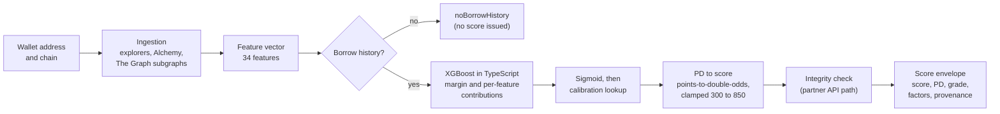

<div align="center">

# ChainScore

**A calibrated credit score for DeFi borrowers, built entirely from public onchain data.**

ChainScore takes a wallet address and returns a 300 to 850 score, a calibrated probability of default, and a breakdown of the factors behind it. The score comes from a gradient-boosted model trained on point-in-time lending histories and tested on a later, held-out period.

[](https://chainscore.dev)
[](ml/model_meta.json)
[](reports/backtest/latest.json)
[](#coverage)

[Live site](https://chainscore.dev) · [Public backtest](https://chainscore.dev/retrospective) · [Partner API](docs/API.md)

</div>

---

## Overview

DeFi lending is almost always overcollateralized. To borrow, a wallet must first lock up collateral worth more than the loan, which keeps lenders safe but leaves credit capital-inefficient and out of reach for anyone who cannot post more than they need. The underlying problem is an information gap. A lending protocol sees only an address and a collateral balance, so a borrower with years of clean repayments looks the same as a wallet created yesterday.

The data needed to close that gap already exists. Every borrow, repayment and liquidation is recorded onchain, permanently and in public. What has been missing is a way to turn that record into a risk estimate a protocol can act on: consistent from one wallet to the next, interpretable by the borrower, and calibrated so that a stated probability matches what actually happens.

ChainScore provides that estimate. Given a wallet address, it reads the wallet's history from public data sources, builds 34 features describing its lending record, activity and holdings, and evaluates a calibrated XGBoost model. It returns a probability of default (PD), the same risk expressed as a score from 300 to 850, and the factors that drove it.

Three design commitments shape the system:

1. **Public data only.** Every input is read from public blockchain data. There is no KYC and no off-chain identity data.
2. **Calibrated, not just ranked.** The model outputs a probability that is calibrated against observed outcomes. The score is a fixed, documented transform of that probability, so a given score always means the same estimated risk.
3. **Explainable by construction.** The headline score and the factor breakdown come from the same pass through the model, so the explanation cannot drift away from the number it explains.

ChainScore is not a lending protocol. It does not hold funds or issue loans. The product is the score and the partner API that serves it.

> **About this repository.** This repository is shared for reference and review. It is the source for the production deployment at chainscore.dev. It depends on private infrastructure and credentials and is not meant to be cloned and run.

---

## How it works



1. **Ingestion.** For the requested wallet and chain, ChainScore fetches several sources in parallel: transaction history from block explorers (Etherscan v2, with Snowtrace for Avalanche), token balances and portfolio flags from Alchemy, and lending and liquidity activity from Aave, Compound and Uniswap subgraphs on The Graph. When a provider fails, it moves to the next source in a fixed order. If the history or lending sources do not answer at all, the wallet is not scored. The service returns the last known good score if it has one, and otherwise an explicit "retry" error. It never treats an outage as an empty history.

2. **Features.** The raw data is turned into the 34 features the model was trained on (listed in `ml/model_meta.json`), grouped into four factor families (see [The model](#the-model)).

3. **Inference in TypeScript.** The model was trained in Python and exported as JSON: a booster dump in `ml/model.json` and metadata in `ml/model_meta.json`. At request time, `lib/data/mlScorer.ts` walks the trees directly inside a Next.js serverless function, so there is no Python runtime in production. A single pass produces both the raw margin and each feature's contribution to it.

4. **Calibration and score.** The margin is converted to a raw probability, then mapped to a calibrated PD with an exported 201-point monotone lookup table. The PD is then converted to a score on a points-to-double-odds scale. That is the convention used in traditional credit scoring: a fixed number of points corresponds to a doubling of the odds of default.

   ```text
   p_raw = sigmoid(margin)
   PD    = calibrate(p_raw)                       # monotone lookup, 201 points
   PD    = min(max(PD, 0.0001), 0.9999)
   score = 196.58 - 104.17 * ln(PD / (1 - PD))
   score = clamp(round(score), 300, 850)
   ```

   The band is anchored so that a PD of 0.30% maps to 800 and a PD of 18.65% maps to 350. Each 72.2 points halves the odds of default. The grade and the percentile come from cutoffs and score deciles exported with the model.

5. **Integrity check.** On the partner API path, the wallet's transaction records go through a set of manipulation detectors. Their output can lower the score by a graded, bounded penalty (see [Score integrity](#score-integrity)).

6. **Response envelope.** Every partner API response is a versioned envelope that records what produced it:

   | Field | Meaning |
   |---|---|
   | `score`, `grade`, `percentile` | Final score after any integrity penalty, with its grade and percentile |
   | `modelScore` | The model's score before the integrity penalty, returned for transparency |
   | `calibratedPD` | Calibrated probability of default |
   | `factors` | Per-family contributions with plain-language explanations |
   | `integrity` | Penalty, flag, and the individual detector signals |
   | `dataCompleteness`, `degradedSources` | How much of the input data actually arrived, and which sources failed |
   | `modelVersion`, `featureSetVersion`, `apiVersion` | Provenance |
   | `asOf`, `computedAt`, `cached`, `stale` | Freshness |
   | `newWallet`, `noBorrowHistory` | States in which no model score is issued |

---

## The model

| Property | Value |
|---|---|
| Version | `v5-xgb-cal` |
| Type | Gradient-boosted trees (XGBoost), calibrated |
| Features | 34, in 4 factor families |
| Target | Liquidation within a fixed 6-month outcome window |
| Unit of analysis | (wallet, chain) pair |
| Training rows | 30,595 (entered the credit system 2017-08-29 to 2024-04-17) |
| Test rows | 7,648 (entered the credit system 2024-04-17 to 2024-05-31) |
| Baseline | Logistic regression |

**Label definition.** A (wallet, chain) pair is positive if the wallet borrowed on a covered lending deployment (Aave V2, Aave V3 or Compound V2) before the observation cutoff of 2024-06-01, and was then liquidated on that chain between 2024-06-01 and 2024-12-01. It is negative if it borrowed before the cutoff and was not liquidated in that window. Wallets that never borrowed are excluded. Every feature uses only data from before the cutoff, so features and outcomes never overlap. The labeled population is 122,221 (wallet, chain) pairs with 11,111 positives, a base rate of 9.09%. The train and test split is temporal, ordered by when each wallet first entered the credit system. The full definition and its point-in-time rules are in [LABELS.md](LABELS.md).

**Feature families.**

| Family | Features | What it captures |
|---|---|---|
| Lending History | 14 | Borrows and repayments on Aave and Compound, prior liquidations, repayment ratio, liquidation rate, borrow velocity, net unpaid borrows |
| Wallet History | 10 | Wallet age, time since first DeFi interaction, transaction counts over several windows, active days and months, DeFi tenure ratio |
| DeFi Activity | 4 | Number of protocols used, Uniswap liquidity provision, staked ETH, governance participation |
| Portfolio & Identity | 6 | Portfolio value, stablecoin share, token diversity, ETH holdings, ENS name, Gnosis Safe account |

**Explainability.** For each tree, the scorer follows the decision path the wallet takes and credits each split's change in node value to the feature that split on. This is the path-based (Saabas) decomposition of a tree ensemble. The contributions plus the bias add up exactly to the model's margin. The per-feature contributions are summed within each family to produce the factor bars shown to users, and the three largest individual contributions are reported separately. Because the explanation and the score come from the same computation, they always agree.

---

## Evaluation

The model is evaluated on a held-out set of wallets that entered the credit system after the training period. The backtest engine (`lib/backtest/engine.ts`) refuses any row whose features were observed after its as-of date, or whose outcome window opens before it.

**Reweighting.** The holdout is an enriched sample: 7,720 rows, 1,933 of them positive, so liquidated wallets make up 25% of rows. Every metric is computed with sample weights that bring it back to the deployed base rate of about 9.1%, so the numbers describe performance at the rate the model would actually face (`lib/backtest/metrics.ts`).

**Headline metrics.**

| Metric | v5-xgb-cal | Logistic regression baseline |
|---|---|---|
| ROC-AUC | 0.849 | 0.833 |
| PR-AUC (average precision) | 0.599 | 0.579 |
| Brier score | 0.053 | |
| Expected calibration error (10 bins) | 0.018 | |

The ChainScore figures are from the backtest holdout (`reports/backtest/latest.json`). The baseline figures are from the training pipeline's test split (`ml/model_meta.json`), which covers the same period but applies one additional filter (see [LABELS.md](LABELS.md), limitation 4). On that same split the XGBoost model scores a ROC-AUC of 0.849 and a PR-AUC of 0.598. PR-AUC is the area under the precision-recall curve. For a classifier that guesses at random, it equals the positive rate, here about 0.091, so 0.599 is about 6.6 times what chance would give. Calibration is monotone, so it does not change how wallets are ranked: the raw and calibrated models have identical ROC-AUC.

**Operating point.** If every wallet scoring below 578 (grades D and F) is flagged, the backtest gives:

| Measure | Value |
|---|---|
| Recall (share of liquidated wallets flagged) | 88% (1,704 of 1,933) |
| False positive rate (share of non-liquidated wallets flagged) | 48% (2,806 of 5,787) |
| Precision at the deployed base rate of about 9.1% | 15.4% |
| Share of all wallets flagged | 52% |

|  | Liquidated | Not liquidated |
|---|---|---|
| Flagged (score below 578) | 1,704 | 2,806 |
| Cleared (578 and up) | 229 | 2,981 |

In plain terms: this cutoff catches nearly nine in ten wallets that went on to be liquidated, but it also flags about half of the wallets that did not. A flagged wallet is about 1.7 times as likely to be liquidated as the average borrower. The cutoff works as a broad screen, not a precise prediction.

**Calibration by bin (weighted).**

| Predicted PD bin | Mean predicted | Observed rate | Rows |
|---|---|---|---|
| 0.0 to 0.1 | 0.026 | 0.028 | 4,986 |
| 0.1 to 0.2 | 0.163 | 0.104 | 896 |
| 0.2 to 0.3 | 0.247 | 0.212 | 665 |
| 0.3 to 0.4 | 0.344 | 0.206 | 308 |
| 0.4 to 0.5 | 0.443 | 0.326 | 128 |
| 0.5 to 0.6 | 0.546 | 0.328 | 50 |
| 0.6 to 0.7 | 0.642 | 0.438 | 18 |
| 0.7 to 0.8 | 0.747 | 0.782 | 13 |
| 0.8 to 0.9 | 0.858 | 1.000 | 5 |
| 0.9 to 1.0 | 0.986 | 1.000 | 651 |

Calibration is close in the lowest bin, which holds most wallets, and in the highest bin. In the middle range (PD 0.1 to 0.7) the model overestimates risk: observed rates fall below predicted ones.

**Performance by segment.**

| Segment | Rows | Positives | ROC-AUC | PR-AUC |
|---|---|---|---|---|
| Wallet age under 180 days | 5,912 | 1,584 | 0.839 | 0.611 |
| Wallet age 180 days or more | 1,808 | 349 | 0.870 | 0.541 |
| 3 or fewer borrows | 7,348 | 1,783 | 0.850 | 0.608 |
| More than 3 borrows | 372 | 150 | 0.737 | 0.352 |
| Ethereum | 3,964 | 647 | 0.814 | 0.412 |
| Arbitrum | 1,000 | 416 | 0.769 | 0.484 |
| Avalanche | 147 | 52 | 0.792 | 0.496 |
| Scroll | 2,609 | 818 | 0.875 | 0.762 |

The holdout has no rows from Optimism, Polygon or Base, so no per-chain figures exist for them. Segment PR-AUC values reflect each segment's own positive rate and should not be compared directly across segments.

**Grades.** Grades are fixed bands on the score. The PD values below follow from the score band.

| Grade | Score range | Calibrated PD range |
|---|---|---|
| A | 774 to 850 | 0.39% or lower |
| B | 643 to 773 | 0.39% to 1.36% |
| C | 578 to 642 | 1.36% to 2.50% |
| D | 452 to 577 | 2.50% to 7.93% |
| F | 300 to 451 | 7.93% or higher |

The median scored borrower in the reference distribution scores 608, which corresponds to a PD of about 1.89%.

---

## Score integrity

A score that is cheap to fake is useless to a lender, so it matters what an adversary can do to manufacture a good one. The threat model assumes an attacker who can create unlimited wallets, script arbitrary onchain activity, and briefly put up real but recoverable capital, but who cannot forge signatures or rewrite chain history. [THREAT_MODEL.md](THREAT_MODEL.md) lists seven attack classes and the defense for each.

**Detectors.** `lib/integrity/detectors.ts` implements four detectors. Each is a pure function that returns a severity between 0 and 1, along with its evidence and a stated reason.

| Detector | Attack targeted | Signal | Weight |
|---|---|---|---|
| Instant repay | Self-funded fake repayment: borrowing and repaying at once to manufacture a clean repayment record | Share of borrows repaid within one block or 60 seconds | 1.0 |
| Wash trading | Self-dealing loops that inflate activity counts | Share of directed activity in reciprocal loops with repeated or related counterparties | 0.8 |
| Sybil funding | Wallet farms funded from a common source | Size of the related cohort that shares a funder | 0.7 |
| Burst timing | Activity concentrated just before a scoring request | Excess concentration in the densest 7-day window, relative to uniform spreading | 0.5 |

On the live partner API path, the wash trading and burst timing detectors run on the transaction records already fetched for scoring. The instant repay and Sybil detectors need lending-event and related-address data that the live path does not yet retain. There they receive no input and contribute nothing. This is stated in `lib/scoring/live.ts`, not hidden.

**Graded, bounded penalty.** The detector signals are combined as a weighted soft-OR: the penalty is 1 minus the product of (1 minus weight times severity) over all detectors. Several independent signals compound, the total never exceeds 1, and no single detector can zero a score on its own. The score falls by up to 250 points in proportion to the penalty, and never goes below 300. A wallet is flagged when the penalty reaches 0.5. The pre-penalty `modelScore` is always returned next to the final score, and the penalty is applied after the model, never inside it.

**Cost to game.** The guiding principle, recorded per feature in [COST_TO_GAME.md](COST_TO_GAME.md), is that a feature's influence should track how expensive it is to fake. Some features cannot be backdated or removed: wallet age, DeFi tenure, real prior liquidations. These are honest signals. Others can be inflated for the cost of gas: raw transaction counts, protocol breadth, token diversity. For those, the detectors, not the feature weights, carry the defense. The stated goal is to make faking a good score cost about as much as actually being a good borrower.

**Entity resolution.** `lib/entity/resolver.ts` implements address clustering for the coupled risk of wallet farms. It scores address pairs on five signals: shared funder, direct gas funding, transactions within 5 minutes of each other, bridge hops between the addresses, and sustained two-way transfers. It combines them with a soft-OR. No single signal can reach the merge threshold of 0.85, and one-way dust transfers cannot link an unrelated wallet into a cluster. Links between 0.5 and 0.85 are reported as probabilities and are not merged. The module also defines a recency-weighted way to combine member scores into one entity score. It is implemented and unit-tested but is not yet called from the live scoring path.

---

## Coverage

| Network | Status | Notes |
|---|---|---|
| Ethereum | Full | Aave V2/V3, Compound V2; complete transaction history |
| Arbitrum | Full | Aave V3; complete transaction history |
| Optimism | Full | Aave V3; complete transaction history |
| Polygon | Full | Aave V3; complete transaction history |
| Base | Full | Aave V3; complete transaction history |
| Avalanche | Reduced history | Borrow detection live; transaction-history features reduced |
| Scroll | Reduced history | Borrow detection live; transaction-history features reduced |
| Solana | Site only | Separate scoring path on the website, not the evaluated model; not yet on the partner API |

Every score reports `dataCompleteness`, a value from 0 to 1 that shows how much of the feature input actually arrived, together with the list of sources that failed. A consumer can therefore tell a confident score from one computed on partial data.

---

## Product surfaces

| Surface | Description |
|---|---|
| Web app | Score pages per wallet (`/score/{address}`), with the factor breakdown, grade and percentile |
| Partner API | Versioned `/api/v1` with bearer-key authentication, per-key rate limiting, a usage endpoint, and HMAC-signed score-change webhooks. The contract is published as OpenAPI 3.1 at `/api/v1/openapi`. See [docs/API.md](docs/API.md). |
| Embed widget | `/embed/{address}`, a public widget for showing a score in a browser without exposing an API key |
| Farcaster frames | `/frames/{address}`, a frame that shares a wallet's score |
| Open Graph images | Score cards generated per address (`/api/og/{address}`) for link previews |
| Public backtest | `/retrospective`, which renders the published backtest report: holdout, operating point, reliability, and per-chain results |

The model statistics shown on the public site are read directly from `ml/model_meta.json` and `reports/backtest/latest.json`, and unit tests (`tests/unit/modelFacts.test.ts`, `tests/unit/publicFacts.test.ts`, `tests/unit/scoreTier.test.ts`) pin the site's claims to those artifacts, so the published numbers cannot silently drift from the model.

---

## Architecture and stack

| Layer | Technology |
|---|---|
| Application | Next.js 14 (App Router), React 18, TypeScript, Tailwind CSS |
| Hosting and compute | Vercel serverless functions |
| Model training | Python, XGBoost, scikit-learn, pandas |
| Model serving | Tree evaluation in TypeScript from exported JSON artifacts |
| Onchain data | Etherscan v2 and Snowtrace explorers, Alchemy, The Graph subgraphs, Helius (Solana) |
| Persistence | Postgres via Prisma |
| Caching and rate limiting | In-memory cache with an Upstash Redis shared layer |
| Wallet connection | viem, wagmi, RainbowKit; Solana wallet adapter |
| Testing and CI | Vitest unit tests, Playwright end-to-end and accessibility tests; GitHub Actions runs typecheck, lint, tests, build, dependency audit and secret scanning |

```text
app/              Pages and API routes: score pages, /api/v1, /embed, /frames, /retrospective, OG images
lib/data/         Provider clients and the model scorer (mlScorer.ts), plus the generated coverage registry
lib/ingest/       Transaction-history ingestion with per-chain source priority, failover and completeness
lib/scoring/      Live scoring path, versioned envelope, caching and webhooks
lib/integrity/    Manipulation detectors and the bounded penalty
lib/entity/       Address-clustering signals and entity score aggregation
lib/backtest/     Point-in-time backtest engine and weighted evaluation metrics
ml/               Exported model artifacts (model.json, model_meta.json) and training scripts
reports/          Published backtest reports (JSON and Markdown)
tests/            Unit tests (Vitest) and end-to-end tests (Playwright)
```

---

## Roadmap

These items extend work the code already sets up for. They are directions, not commitments.

- Retain lending events and related-address data on the live path, so that the instant repay and Sybil funding detectors run on every partner API score.
- Connect the entity resolver to live scoring, so that clustered wallets are scored as one entity.
- Restore full transaction-history features for Avalanche and Scroll.
- Bring Solana scoring to the partner API.
- Re-run labeling on later outcome windows under a new criteria version, to measure how stable the model is across market regimes.

---

## Further reading

- [LABELS.md](LABELS.md): the exact label definition, observation window, point-in-time discipline and known limitations
- [THREAT_MODEL.md](THREAT_MODEL.md): the attacker model and the catalogue of manipulation attacks and defenses
- [COST_TO_GAME.md](COST_TO_GAME.md): manipulation cost for each feature, and the design response
- [reports/backtest/](reports/backtest/): the published backtest reports
- [docs/API.md](docs/API.md): the partner API reference

---

<div align="center">

Built by Dhrish Jariwala · [chainscore.dev](https://chainscore.dev)

</div>
